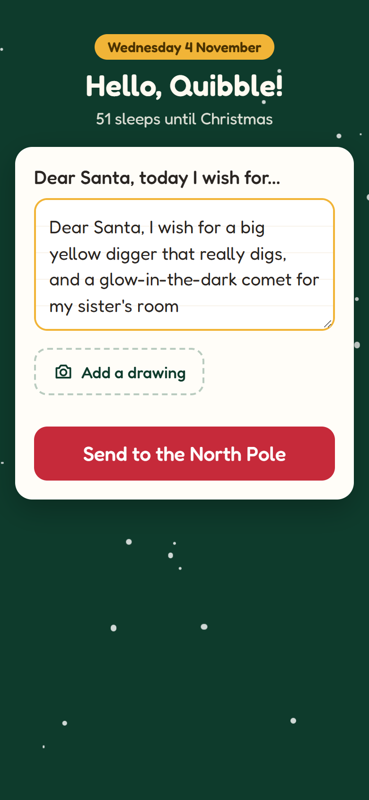
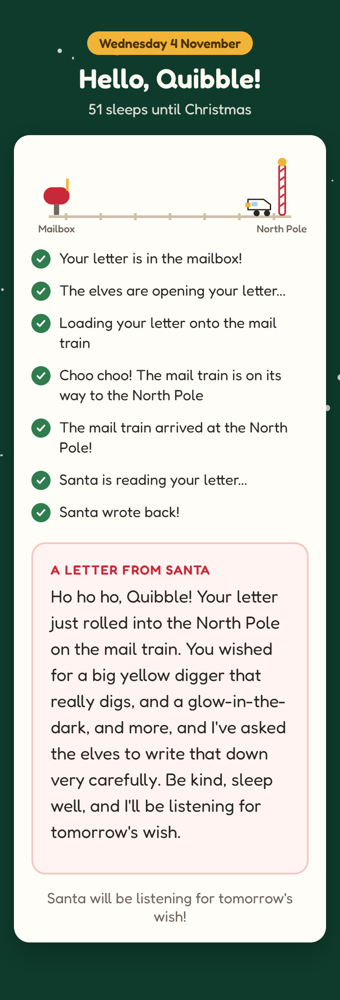
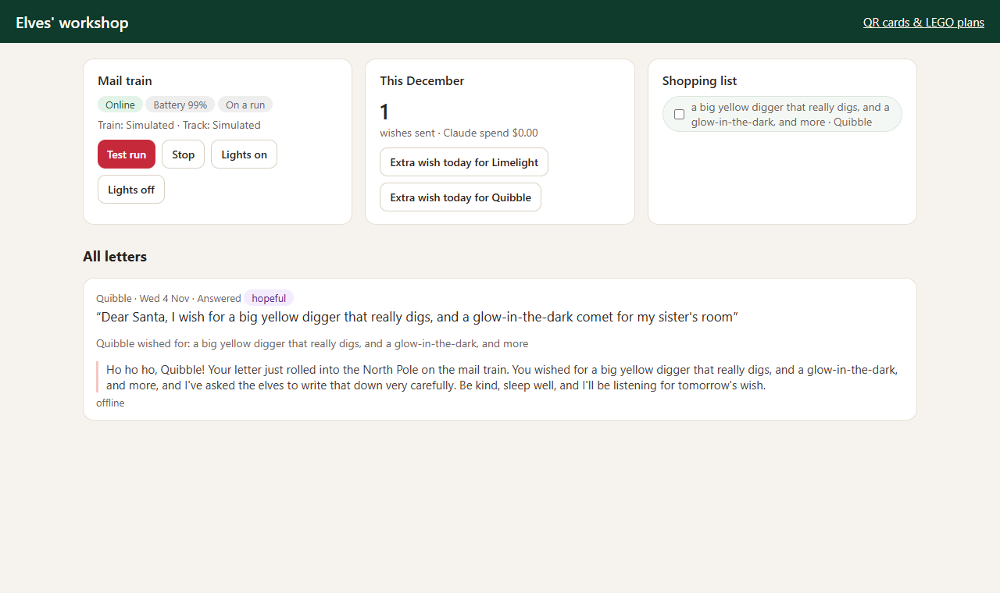

# Santa's Mail Train

A Christmas build for families: a LEGO train carries each child's letter to the North Pole, and Santa writes back.

A child scans their own QR card, printed or **built from LEGO tiles**, and a wish page opens on a phone. They write today's wish, and can add a photo of a drawing. While a LEGO City train carries the letter from a mailbox to the North Pole station, Claude reads it as Santa. When the train arrives, Santa's reply is spoken from a speaker at the station and appears on the phone. Grown-ups get a PIN-protected dashboard with every letter, a shopping list that builds itself, and a gentle heads-up if a letter sounds worried or sad.

| The wish page | Santa's answer | The parents' dashboard |
|---|---|---|
|  |  |  |

*Screenshots from the laptop simulation, with the offline Santa and the sample family.*

## Contents

- [How it works](#how-it-works)
- [What you need](#what-you-need)
- [Try it on your computer first](#try-it-on-your-computer-first)
- [Wiring the track](#wiring-the-track)
- [Configuration](#configuration)
- [Deploying to the Raspberry Pi](#deploying-to-the-raspberry-pi)
- [Backups](#backups)
- [Using it](#using-it)
- [Safety](#safety)
- [Troubleshooting](#troubleshooting)
- [Making it your own](#making-it-your-own)
- [Project status](#project-status)
- [License](#license)

## How it works

```
 phone ──Wi-Fi──▶ Raspberry Pi 5
                  ├─ HQ ──────────── MQTT on localhost ──▶ signal box ──Bluetooth──▶ LEGO hub in the train
                  │  web pages, QR + LEGO plans            │  station sensors, mailbox-flag servo,
                  │  Claude (Santa's brain)                │  red/green signal, 16x2 station board,
                  │  Piper (Santa's voice) ──▶ speaker     │  safety interlock
                  │  embedded MQTT broker                  └──GPIO──▶ the track
```

One Raspberry Pi 5 beside the track runs two services that talk MQTT to each other. **HQ** serves the pages, asks Claude to write Santa's reply, speaks it with [Piper](https://github.com/rhasspy/piper), and runs the MQTT broker. The **signal box** drives the train over Bluetooth, reads the station sensors, and works the mailbox flag, the signal lights and the station board. Keeping them apart puts the train's safety rules in a process of their own: if HQ stops, the train brakes. They can also [run on two Pis](#splitting-across-two-pis).

| Project | Runs on | Does |
|---|---|---|
| `NorthPole.Contracts` | Pi 5 | MQTT topics and message records. No dependencies, so other clients (a Unity twin, say) can reuse the files. |
| `NorthPole.Messaging` | Pi 5 | A small MQTTnet wrapper: typed publish/subscribe, auto-reconnect, and an optional embedded broker. |
| `NorthPole.Hq` | Pi 5 | ASP.NET Core: the children's pages, the parents' dashboard, QR cards and LEGO plans, Claude, Piper, JSON storage. |
| `NorthPole.SignalBox` | Pi 5 | A worker service: drives the train, reads the sensors, moves the servo, shows each run on the station board, and enforces speed limits and timeouts. |
| `deploy/` | your computer, then the Pi | `publish.sh` (or `publish.ps1` on Windows) builds both apps and copies them over SSH; `pi/setup.sh`, the systemd units and the Echo scripts set up the Pi; `backup.ps1`, `restore.ps1` and `pi/backup.sh` keep the Pi's own data safe. |

### The journey of one wish

1. **Mailbox.** The page shrinks any photo to 1280 px in the browser before posting it. Each child gets one wish a day; parents can grant extras.
2. **The elves read it.** HQ calls Claude with structured outputs (`Messages.Create<SantaReading>()`), so the reply always parses. It returns Santa's reply, a summary for parents, gift ideas, the letter's mood, a private heads-up for parents when one is needed, and a description of any drawing. The system prompt (persona, family, house rules) is cached, since it's the same for every letter.
3. **The mail train**, at the same time. HQ publishes a dispatch over MQTT. The signal box raises the mailbox flag, blinks the headlights, sets the signal green and drives to the North Pole, then slows down and brakes at the station sensor.
4. **Santa speaks.** An optional arrival jingle plays, then Santa's voice on the station speaker. The reply appears on the phone with a **Hear Santa** button.
5. **Home.** HQ tells the train to return, and it drives on round the loop to the mailbox, ready for the next letter. Letters that arrive mid-run wait their turn.

**If anything is off, the magic doesn't break.** No train, flat batteries or a timeout: "Rudolph flew your letter instead", and Santa still answers. No Claude: a built-in offline Santa answers. No voice: the reply is text only.

### Santa's rules

The prompt lives in `src/NorthPole.Hq/Santa/SantaPrompt.cs`:

- Santa uses the child's name and the actual wish, and comments on the drawing.
- He matches the child's age, and can mention an earlier wish so they feel remembered.
- He **never promises a present**, and never mentions prices, shops or who buys gifts.
- A sad or worried letter gets a gentle reply, and an alert on the parents' dashboard.
- The letter is wrapped in `<letter>` tags and treated as the child's words, never as instructions.

A letter is roughly 1,500 input and 300 output tokens, about a cent with Claude Sonnet at the time of writing; check current pricing. The dashboard shows the running total.

### QR codes you can build from LEGO

A phone can scan a QR code made of studs. The trick is writing the URL in **upper case** (`HTTP://NP.LOCAL/W/K7Q2`): that lets the code use its compact alphanumeric mode, and it's safe because URL schemes and hostnames ignore case and the app's routes are case-insensitive. Such a URL fits a **version 1 code, 21 × 21 modules**. Centred on a white 32 × 32 baseplate, it takes about 130 black 1×N tiles.

The **QR cards & LEGO plans** page draws a build plan for each child: the tile layout with stud coordinates and lengths, and a parts list with BrickLink design IDs.

- Keep `Qr:BaseUrl` short. The setup names the Pi 5 `np` and serves on port 80, giving `http://np.local`. An IP address with a port needs a version 2 code (25 × 25, about 170 tiles), which still fits.
- Tiles scan better than plates, because they have no shiny studs. Test each card with each phone in room light.

## What you need

### Hardware

| Item | Notes |
|---|---|
| LEGO City train with a Powered Up hub (88009) | Built and set up for 60337 Express Passenger Train: motor on port A, lights on port B. Other Powered Up trains should work; set the ports in the configuration. The train only runs forwards, so put the mailbox and the North Pole on opposite sides of a loop. |
| Raspberry Pi 5, 4 GB or more | Runs everything. Put it beside the track by the mailbox, since the sensors, servo, LEDs and station board are wired to it. Use the official 27 W supply. Its built-in Bluetooth drives the hub. |
| microSD card, 32 GB or more | 64-bit Raspberry Pi OS (Bookworm or later), Lite recommended. |
| Speaker at the North Pole | The Pi 5 has no headphone jack: a Chromecast speaker or soundbar on the same Wi-Fi (see [Santa's voice on a Chromecast speaker](#santas-voice-on-a-chromecast-speaker)), a USB speaker on a long enough cable, or an Amazon Echo over Bluetooth (see [Santa's voice on an Amazon Echo](#santas-voice-on-an-amazon-echo)). |
| Standard USB Bluetooth adapter | Optional: only if the Echo and the train share the radio badly (see [Bluetooth on one Pi](#bluetooth-on-one-pi)). |
| Magnetic door contact (reed switch) and magnet | The North Pole sensor; the magnet rides on the locomotive. |
| HC-SR04 ultrasonic sensor, plus 1 kΩ and 2 kΩ resistors | The mailbox sensor. The resistors protect the Pi from its 5 V Echo pin. IR obstacle modules (FC-51, TCRT5000) also work. |
| SG90 micro servo | Raises the mailbox flag. |
| Red and green 5 mm LEDs, 2 × 220 Ω | The signal. |
| 16x2 character LCD with an HD44780-compatible controller (such as the JHD162A), a 10 kΩ trimmer and a 220 Ω resistor | Optional: the station board. 5 V. |
| Breadboard and jumper wires | Long enough to reach both stations from the Pi. |

### Software and accounts

- The **.NET 10 SDK** on your computer, to build and to run the simulation.
- **bash, ssh and rsync** to deploy. On Windows, use WSL.
- A **Claude API key** from the [Claude Console](https://console.anthropic.com/), with some credit. Optional: without one, the offline Santa answers.
- A **Wi-Fi network** that the Pi and the phones join.

## Try it on your computer first

No hardware and no API key needed:

```bash
dotnet run --project src/NorthPole.Hq          # opens http://localhost:8080/elves (PIN 1225)
dotnet run --project src/NorthPole.SignalBox   # in a second terminal: a simulated train and track
```

Both run in simulation: the offline Santa, no voice, and a pretend train that takes 6 seconds between stations. In the dashboard, open **QR cards & LEGO plans** and click a child's link, or scan the card with a phone on the same Wi-Fi.

To try the real Claude, give HQ your key and run the "Laptop with real Claude" launch profile:

```bash
dotnet user-secrets set "NorthPole:Santa:ApiKey" "sk-ant-…" --project src/NorthPole.Hq
dotnet run --project src/NorthPole.Hq --launch-profile "Laptop with real Claude"
```

User secrets live in your user profile, outside the repo. Setting `ANTHROPIC_API_KEY` in your environment works too.

## Wiring the track

Everything at the track wires to the Pi 5's 40-pin header (the same pins on a Pi 4). BCM pin numbers; every one is configurable. Physical pin 1 is the square pad.

| Part | Pin | Physical pin |
|---|---|---|
| North Pole magnetic contact, one wire / the other | GPIO17 / GND | 11 / 9 |
| Mailbox HC-SR04 Trig | GPIO22 | 15 |
| Mailbox HC-SR04 Echo, through 1 kΩ (and 2 kΩ from GPIO27 to GND) | GPIO27 | 13 |
| Mailbox HC-SR04 Vcc / Gnd | 5 V rail / GND | 4 / 20 |
| Red LED, through 220 Ω | GPIO23 | 16 |
| Green LED, through 220 Ω | GPIO24 | 18 |
| LED cathodes | GND | 14 |
| Servo signal (orange) | GPIO18 (PWM0) | 12 |
| Servo power (red / brown) | 5 V / GND | 2 / 6 |
| Station board RS / E (LCD pins 4 / 6) | GPIO5 / GPIO6 | 29 / 31 |
| Station board D4 / D5 / D6 / D7 (LCD pins 11 to 14) | GPIO13 / GPIO19 / GPIO26 / GPIO21 | 33 / 35 / 37 / 40 |
| Station board VSS, RW, backlight K (LCD pins 1, 5, 16) | GND | 39 |
| Station board VDD, and backlight A through 220 Ω (LCD pins 2, 15) | 5 V rail | 4 |

Pin 4 feeds a 5 V rail on the breadboard, shared by the HC-SR04 and the LCD. The LCD's contrast pin (3) goes to the trimmer's middle leg, with its outer legs on 5 V and ground; its D0 to D3 (pins 7 to 10) stay unconnected.

> **Two pins need care.** The **HC-SR04's Echo outputs 5 V**, which can damage a Pi pin: the 1 kΩ / 2 kΩ divider brings it down to about 3.3 V. **The LCD's RW pin must go to ground**, which keeps it in write mode, so its 5 V never reaches the Pi. Everything else is safe on the Pi's 3.3 V.

Switch the Pi off before wiring, and check with a multimeter before powering on: no short between 5 V and ground, and the resistors where they should be. If the Pi resets when the servo moves, give the servo its own 5 V supply and join the grounds.

### Placing the sensors

Each station's sensor is set in `Trackside:NorthPoleSensor` and `Trackside:HomeSensor`, with a `Kind` of `Magnet`, `Infrared`, `Ultrasonic` or `None`:

- **Magnet** (reed or Hall switch): fix the contact beside the track and the magnet on the side of the locomotive, within about 1.5 cm as it passes. Its first pulse counts. Most contacts close near the magnet, which is what `ActiveLow: true` expects; if yours reads the other way round, set it to `false`.
- **Ultrasonic** (HC-SR04): beside the track at coach height, aimed across the rails at open space, with nothing within about 30 cm beyond. Two close echoes in a row count as the train, so a stray echo doesn't.
- **Infrared** (FC-51, TCRT5000): powered from 3.3 V; it must still see the train after 30 ms, which ignores flickers.
- **None**: only for the mailbox. The train then parks at the North Pole.

Put each sensor a little *before* its platform. When it trips, the train slows to `ApproachSpeed`, then brakes; tune the speeds and positions together until it stops at the platform.

### The station board

An optional 16x2 LCD by the mailbox, like a departure board. Anyone in the room can read it, so it shows a first name and where the letter is, never what the letter says.

| When | Top line | Bottom line |
|---|---|---|
| Waiting | `North Pole Mail` + a tree | takes turns: `Scan your card!`, `22 sleeps to go`, `Train ready 87%` |
| Loading | `Quibble's letter` | `Loading the post` |
| On the way | `Quibble's letter` | a little train running along to the tree |
| At the North Pole | `Quibble's letter` | `Santa's reading!` |
| Going home | `Letter delivered` | the train running along |
| A run failed | `Train stopped` | `Grown-up needed` (until the next run) |
| Something's off | `North Pole Mail` | `HQ not answering`, `Train is asleep` or `Battery low: 12%` |

The envelope, train and tree are the LCD's custom characters. Its character set is plain ASCII, so accents come off (Zoë shows as Zoe). Keep its wires under about 50 cm. To run without a board, set `Trackside:Board:Enabled` to `false`.

### Testing one part at a time

The signal box has a bench mode that drives one part at a time through the same code as a mail run, and opens only the pins that test needs. Wire a part, try it, then add the next. Run it on the Pi with the signal box service stopped (`sudo systemctl stop northpole-signalbox`), or before you install anything: from Windows, `deploy/bench.ps1` builds a self-contained copy and puts it in `~/northpole-bench` on the Pi, with no WSL needed.

```powershell
.\deploy\bench.ps1 -PiHost you@np.local
```

Then, on the Pi:

```bash
~/northpole-bench/NorthPole.SignalBox bench signal             # red 3 s, green 3 s, four swaps, then off
~/northpole-bench/NorthPole.SignalBox bench signal green 10    # hold one aspect
~/northpole-bench/NorthPole.SignalBox bench wait               # count magnet passes at the North Pole contact for 60 s
~/northpole-bench/NorthPole.SignalBox bench distance           # live readings from the mailbox HC-SR04 for 60 s
~/northpole-bench/NorthPole.SignalBox bench flag               # the mailbox flag: down, up, down, up, down
~/northpole-bench/NorthPole.SignalBox bench flag duty 0.06     # hold any position, to tune FlagUpDuty and FlagDownDuty
~/northpole-bench/NorthPole.SignalBox bench board              # a pretend mail run on the station board, screen by screen
~/northpole-bench/NorthPole.SignalBox bench board text "Hello" # any two lines
~/northpole-bench/NorthPole.SignalBox bench train              # the locomotive over Bluetooth: battery, headlights, a slow nudge
~/northpole-bench/NorthPole.SignalBox bench train power 30 3   # hold one motor power for 3 s, then brake
```

The signal LEDs tell you what each test wants. Red means it's waiting for you: bring the magnet or your hand to the sensor, or press the hub's green button. Green means it has seen it, the flag is moving, or the train is connected. For the train, press the hub's green button so its light flashes, and keep the LEGO remote switched off: the hub takes one connection at a time. Your user needs to be in the `gpio` group, as the first user on Raspberry Pi OS is. The installed copy works the same way: `/opt/northpole/signalbox/NorthPole.SignalBox bench …`.

## Configuration

Each app reads JSON settings files next to it, then environment variables, and **the later source wins**:

1. `appsettings.json`
2. `appsettings.{Environment}.json`: `appsettings.Pi.json` on the signal box (its service sets `DOTNET_ENVIRONMENT=Pi`), `appsettings.Development.json` on your computer
3. user secrets (HQ, on your computer only)
4. environment variables, which on HQ include everything in `/etc/northpole/hq.env`

In an environment variable, each `:` becomes `__`: `NorthPole:Elves:Pin` is `NorthPole__Elves__Pin`.

Every value is one of three kinds:

- **Secret**: the Claude API key and the dashboard PIN. They go in `/etc/northpole/hq.env`, which only root can read. Never commit them.
- **Private**: the children's names, ages and notes, the family lore, and HQ's `data/` folder (letters, drawings, voice files, card codes). Edit these on the Pi, not in your fork; `.gitignore` keeps `data/` out of git.
- **Plain**: everything else.

### Where each file lives

| File | Where | Holds | Kind |
|---|---|---|---|
| `hq.env` | `/etc/northpole/` | `ANTHROPIC_API_KEY`, `NorthPole__Elves__Pin` | Secret |
| `appsettings.json` | `/opt/northpole/hq/` | The family, Santa, voice and speaker, the QR address | Private |
| `data/` | `/opt/northpole/hq/data/` | Letters, photos, voice files, card codes. Back it up; updates never touch it | Private |
| `appsettings.json` | `/opt/northpole/signalbox/` | Speeds, battery limit, sensors, pins, the station board, timings | Plain |
| `appsettings.Pi.json` | `/opt/northpole/signalbox/` | The broker address, `Train:Mode`, `Trackside:Mode`. It wins over `appsettings.json`, so change these three here | Plain |
| `*.service` | `/etc/systemd/system/` | How systemd runs HQ, Piper and the signal box. Setup installs them | Plain |

### `/etc/northpole/hq.env`

```bash
ANTHROPIC_API_KEY=sk-ant-…
NorthPole__Elves__Pin=4821
```

One `KEY=value` per line, with no spaces around `=` and no `export`; `#` starts a comment. Setup creates the file with placeholders. After a change, run `sudo systemctl restart northpole-hq`.

### HQ settings (`appsettings.json`, under `NorthPole`)

| Key | Default | What it does | Kind |
|---|---|---|---|
| `Family` | Limelight and Quibble, as examples | **Must change.** One entry per child: `Id`, `Name`, `Age`, `AboutMe`. Use a lower-case `Id`, and don't change it after printing the cards: it ties the child to their card and their letters. | Private |
| `Santa:FamilyLore` | an example | **Should change.** Your elves' names, pets and traditions, for Santa to mention. | Private |
| `Elves:Pin` | `1225` | **Must change.** The dashboard PIN; set it in `hq.env` instead. | Secret |
| `Santa:ApiKey` | empty | Leave empty on the Pi; the key goes in `hq.env`. | Secret |
| `Santa:Brain` | `Claude` | `Offline` for the template Santa, with no key. | Plain |
| `Santa:Model` | `claude-sonnet-5-5` | The Claude model. | Plain |
| `Santa:RememberWishes` | `5` | How many earlier letters Santa sees. | Plain |
| `Santa:Language` | `British English` | Santa's language; pick a matching Piper voice. | Plain |
| `WishesPerDay` | `1` | Wishes per child per day; the dashboard can grant extras. | Plain |
| `Voice:Mode` | `Piper` | `None` for text only. | Plain |
| `Voice:PiperUrl`, `Voice:PiperVoice` | `http://localhost:5000`, empty | Where Piper listens; must match `piper.service`. | Plain |
| `Voice:LengthScale` | `1.15` | Above 1 speaks more slowly. | Plain |
| `Voice:PlayOnStation`, `Voice:PlayCommand` | `true`, `aplay -q` | Whether and how Santa plays at the station. | Plain |
| `Voice:CastTo` | empty | A Chromecast speaker to play Santa on instead, by its name in the Google Home app or its IP address. Empty plays on the Pi with `PlayCommand`, which is also the fallback. | Plain |
| `Voice:CastVolumeAbove`, `CastVolumeMin`, `CastVolumeMax` | `0.15`, `0.35`, `0.7` | Santa plays this far above the speaker's current volume (the TV's), within these limits; the volume goes back after. The dashboard's loudness slider changes how far above (0 to 0.3) and keeps it in `data/santa-loudness.json`. | Plain |
| `Voice:ArrivalSound` | `sounds/arrival.wav` | A jingle before Santa speaks, inside `data/`. | Plain |
| `Qr:BaseUrl` | `http://np.local` | The address in every QR code. Change it before printing, only if phones can't reach `np.local`. | Plain |
| `Qr:BaseplateStuds` | `32` | The baseplate size for the LEGO plan. | Plain |
| `Mqtt:EmbeddedBroker`, `Mqtt:Port` | `true`, `1883` | HQ runs the broker. It has no authentication; see [Safety](#safety). | Plain |
| `DataDirectory` | `data` | Where letters, drawings and voices are kept. | Plain |
| `Urls` (top level) | `http://0.0.0.0:80` | Port 80 keeps the QR address short. | Plain |

### Signal box settings (under `SignalBox`)

The signal box holds no secrets. Its defaults match the wiring above.

| Key | Default | What it does |
|---|---|---|
| `Mqtt:Host`, `Mqtt:Port`, `Mqtt:ClientId` | `localhost` (from `appsettings.Pi.json`), `1883`, `signalbox` | HQ's broker, on the same Pi. Only a [split across two Pis](#splitting-across-two-pis) changes it. |
| `Train:Mode` | `BlueZ` (from `appsettings.Pi.json`) | `BlueZ` (Linux Bluetooth), `PoweredUp` (SharpBrick with a BlueGiga BLED112 dongle) or `Simulated`. |
| `Train:BluetoothAdapter`, `Train:BlueGigaPort` | `hci0`, `/dev/ttyACM0` | Which radio: `hci1` for a USB adapter. |
| `Train:MotorPort`, `Train:LightPort`, `Train:ReverseDirection` | `0`, `1`, `false` | The hub's ports (A = 0); flip the direction if the train drives backwards. |
| `Train:CruiseSpeed`, `Train:ApproachSpeed`, `Train:MaxSpeed` | `45`, `25`, `70` | Speeds in percent; `MaxSpeed` caps whatever is asked for. |
| `Train:LowBatteryPercent` | `15` | Below this, runs are refused and Rudolph flies. |
| `Trackside:Mode` | `Gpio` (from `appsettings.Pi.json`) | `Gpio` or `Simulated`. |
| `Trackside:NorthPoleSensor` | `Magnet` on GPIO17, `ActiveLow: true` | The North Pole sensor. |
| `Trackside:HomeSensor` | `Ultrasonic`: Echo GPIO27, Trig GPIO22, within 8 cm | The mailbox sensor. |
| `Trackside:RedLedPin`, `Trackside:GreenLedPin` | `23`, `24` | The signal. |
| `Trackside:ServoEnabled`, `ServoPwmChip`, `ServoPwmChannel`, `FlagDownDuty`, `FlagUpDuty` | `true`, `-1`, `-1`, `0.05`, `0.075` | The mailbox flag. Chip and channel `-1` find GPIO18's hardware PWM for the board: channel 2 of the RP1 PWM block on a Pi 5, channel 0 on a Pi 4. Tune the duties to your flag. |
| `Trackside:Board` | `Enabled: true`, RS 5, E 6, D4–D7 13, 19, 26, 21 | The station board. |
| `Run:LoadingSeconds`, `ArrivalTimeoutSeconds`, `MaxWaitAtNorthPoleSeconds`, `StatePublishSeconds` | `3`, `60`, `90`, `10` | The run's timings. |

After editing a JSON file, check it, because a stray comma stops the app starting:

```bash
python3 -m json.tool /opt/northpole/hq/appsettings.json > /dev/null && echo OK
```

## Deploying to the Raspberry Pi

The Pi's default hostname is `np`, which keeps the QR address short. Replace `you` below with the username you choose.

1. **Flash the card** with Raspberry Pi Imager: Raspberry Pi OS Lite (64-bit). In its OS customisation, set the hostname to `np`, your username and password, and your Wi-Fi, and turn on SSH. Name it now: the next steps copy to `np.local`.
2. **Check you can reach it**, and set up an SSH key so you aren't asked for a password on every copy:
   ```bash
   ssh-keygen -t ed25519
   ssh-copy-id you@np.local
   ```
   If `.local` names don't resolve (common in WSL and on some routers), use the Pi's IP address instead.
3. **Publish** from the repo. This builds both apps for `linux-arm64` and copies them, with the setup files, to the Pi:
   ```bash
   PI_HOST=you@np.local bash deploy/publish.sh
   ```
   On Windows, without WSL, the PowerShell twin does the same with the `ssh`, `scp` and `tar` that come with Windows:
   ```powershell
   .\deploy\publish.ps1 -PiHost you@np.local
   ```
4. **Wire the track** with the Pi switched off, as described in [Wiring the track](#wiring-the-track).
5. **Run the setup.** It installs the .NET 10 runtime, Piper with a British voice, libgpiod (the Pi 5 reaches its GPIO through it), BlueZ, the servo's PWM overlay, and the three services. Then add your secrets and your family, and reboot:
   ```bash
   ssh you@np.local
   cd ~/northpole-setup && bash setup.sh
   sudo nano /etc/northpole/hq.env            # ANTHROPIC_API_KEY and NorthPole__Elves__Pin
   nano /opt/northpole/hq/appsettings.json    # Family and Santa:FamilyLore
   sudo reboot
   ```
   Optionally drop a jingle at `/opt/northpole/hq/data/sounds/arrival.wav`.
6. **Connect the speaker.** Name a Chromecast speaker in `hq.env` (below), or plug in a USB speaker and test it with `speaker-test -t wav -c 2 -l 1`, or set up an Echo (below). The dashboard's **Test Santa's voice** then has Santa say a line on it.
7. **Wake the train.** Put it at the mailbox and press the green button on the hub. The signal box keeps scanning until it finds it, and the dashboard then shows it Online.
8. **Print the cards.** Open `http://np.local/elves`, enter your PIN, and open **QR cards & LEGO plans**.

Logs: `journalctl -u northpole-hq -u northpole-signalbox -f`.

### Updating

Run `publish.sh` (or `publish.ps1`) again, then on the Pi copy the new builds in and restart. The `--exclude` keeps your settings:

```bash
sudo rsync -a --exclude 'appsettings*.json' ~/northpole-hq/ /opt/northpole/hq/ && sudo systemctl restart northpole-hq
sudo rsync -a --exclude 'appsettings*.json' ~/northpole-signalbox/ /opt/northpole/signalbox/ && sudo systemctl restart northpole-signalbox
```

Running `setup.sh` again also keeps your settings files, and neither touches `hq.env` or `data/`. A setting that's new in an update uses its default until you add it.

### Santa's voice on a Chromecast speaker

A soundbar or speaker with Chromecast built in can be the station speaker over the home Wi-Fi, with no Bluetooth and nothing sent to the internet: HQ shares Santa's reply on the network and the speaker fetches it from the Pi. Put its name, as the Google Home app shows it, in `/etc/northpole/hq.env` and restart HQ:

```bash
echo 'NorthPole__Voice__CastTo=Living Room Soundbar' | sudo tee -a /etc/northpole/hq.env
sudo systemctl restart northpole-hq
```

Santa cuts in on whatever the speaker is playing, 15 points above its volume (between 35% and 70%), and the TV comes back by itself after. A TV with Chromecast is a Chromecast too, which is why the speaker goes by name. If the speaker doesn't answer, Santa plays on the Pi with `PlayCommand` instead.

HQ keeps a link to the speaker from start-up, so the dashboard's **Santa's speaker** panel shows whether it answers and since when, its volume, and the volume Santa will play at, with a slider for how far above the TV he plays. **Disconnect** closes the link and keeps Santa on the Pi until **Connect**.

### Santa's voice on an Amazon Echo

An Echo can be the station speaker over Bluetooth; Santa still speaks in the Piper voice. On the Pi, from `~/northpole-setup`:

1. Say "Alexa, pair Bluetooth", then run `bash echo-speaker.sh`. It installs BlueALSA and sox, and lists the speakers it can see.
2. Run `bash echo-speaker.sh AA:BB:CC:DD:EE:FF` with your Echo's address. It pairs, trusts and connects it, points `Voice:PlayCommand` at it, and restarts HQ.

Before each reply, `santa-play` reconnects the Echo if it dropped the link, and adds half a second of silence so a waking speaker doesn't swallow the first word. Pair it before the children are watching, since the Echo announces the connection. This route needs Raspberry Pi OS Lite; on the desktop edition PipeWire handles Bluetooth audio, so pair from its menu and set `Voice:PlayCommand` to `pw-play`.

### Bluetooth on one Pi

The Pi 5's one radio carries the Wi-Fi, the link to the train's hub and, with an Echo, Santa's voice. Bluetooth can serve the hub and the Echo at the same time, and they rarely overlap, since Santa speaks while the train waits at the North Pole. If his voice crackles or the train drops its link while the Echo plays, plug in a standard USB Bluetooth adapter and give it the train: set `Train:BluetoothAdapter` to `hci1`. A USB speaker avoids the question.

### Splitting across two Pis

If Santa should speak far from the track, the signal box can run on a second Pi beside the track (a Pi 4 works), with HQ's Pi 5 at the North Pole:

1. Flash the second Pi as above, named, for example, `signalbox`.
2. Publish to both: `PI_HOST=you@np.local SIGNAL_HOST=you@signalbox.local bash deploy/publish.sh`.
3. Run `bash setup.sh hq` on the Pi 5, and `bash setup.sh signalbox` on the second Pi. That sets the signal box's broker address to `np.local`, in its `appsettings.Pi.json`; use HQ's IP address there if `np.local` doesn't resolve.

The safety rules work the same: if the signal box loses HQ, the train brakes.

### Santa in another language

Set `Santa:Language` (for example, "Polish"), download a matching [Piper voice](https://github.com/rhasspy/piper/blob/master/VOICES.md), and change the voice name in `piper.service`.

## Using it

**For the children**

1. Point the phone's camera at your card and tap the link.
2. Write today's wish, and tap **Add a drawing** to send a photo of a picture.
3. Tap **Send to the North Pole**, and watch the flag go up and the train set off.
4. Santa answers out loud at the North Pole, and his letter appears on the phone.

**For grown-ups**

- Each morning, park the train at the mailbox and press its green button. Swap the six AAA batteries when the dashboard shows them low.
- The dashboard (`http://np.local/elves`) has the train's status (how long the hub has been connected, its battery in percent and volts, and how fresh the news is, updated every few seconds), **Connect** and **Disconnect** for the train's hub, **Test run** and **Stop run**, a **Train driver** (Forward, Reverse and Stop, a speed slider in steps of 10 up to `MaxSpeed`, and the lights); **Santa's speaker** (a Chromecast one's link and how long it has held, its volume and Santa's, **Connect** and **Disconnect**, a slider for **Santa's loudness**, and **Test Santa's voice**, with a box for your own words); each child's **Extra wish today**; the shopping list; and every letter with its mood and Santa's reply. A worried or sad letter shows as an alert at the top.
- **The Train Driver card** on **QR cards & LEGO plans** opens `http://np.local/driver`: the train's status, **Connect** and **Disconnect**, and the driver's Forward, Reverse, Stop, speed and lights, with no PIN and no Test run. Anyone on the home Wi-Fi with the card can drive; the signal box keeps its speed cap, won't drive during a mail run, and brakes if HQ goes quiet. **Stop** works there too, and ends a mail run as it does on the dashboard.
- **Lost card?** On **QR cards & LEGO plans**, click **Lost this card? Make a new code** under it. The old card and its LEGO mosaic stop working at once, and the new card is ready to print.
- **After a power cut** everything starts by itself, and today's unfinished letters carry on. If the dashboard shows the train Offline, press its green button, and make sure it's back at the mailbox before the next letter. For a planned shutdown, use `sudo poweroff` rather than pulling the plug.

## Backups

Some of what matters lives only on the Pi's card: the QR card codes (a new code means a new card and a new LEGO mosaic), every letter with its gift ideas and what's been bought, the drawings and Santa's voice files, and the settings that hold your family. A fresh card starts without them, so keep snapshots off the Pi.

- **On the Pi, every night:** `setup.sh` installs `northpole-backup` and a timer that snapshots HQ's `data/` folder and the settings files into `~/northpole-backups` at 03:15, keeping the newest 14. Those protect against mistakes, but not against losing the card. `bash setup.sh backup` adds just this to a Pi that's already set up.
- **On your PC, daily:** `.\deploy\backup.ps1 -PiHost pi@np.local` makes a fresh snapshot and copies it to `Documents\NorthPole backups`, keeping the newest 60; `-Schedule` adds a Windows task that does it every evening. Run it by hand too, before you reflash the card. A cloud-synced folder for `-To` gives a copy away from the house as well.
- **The secrets stay out:** snapshots never hold the Claude key or the PIN from `/etc/northpole/hq.env`. Keep those in your password manager, and keep the family's settings in `appsettings.json` rather than `hq.env`, so snapshots carry them.

To restore, after a fresh card or on a new Pi: publish and run `setup.sh` as usual, then

```powershell
.\deploy\restore.ps1 -PiHost pi@np.local     # copies the newest snapshot over and prints the line below
```

```bash
sudo bash ~/northpole-setup/restore.sh ~/northpole-np-20261215-210000.tar.gz
```

`restore.sh` stops HQ and the signal box, sets aside what's there in `/var/backups`, unpacks the snapshot and starts them again. Put the key and the PIN back in `hq.env`, and every card works as before.

## Safety

HQ, and the AI behind it, can only *ask* the signal box to do things. The signal box decides:

- Every speed request is clamped to `MaxSpeed`.
- Every leg has an arrival timeout, after which the train brakes and the run reports a failure.
- If the link to HQ drops while the train is moving, it brakes at once.
- Below `LowBatteryPercent`, runs are refused and Rudolph takes the letters.
- If the signal box stops, its MQTT "last will" tells HQ the train is offline.
- The dashboard's **Stop run**, and the train driver's **Stop**, brake at once and end the run in progress.
- **Disconnect** brakes, ends any run, lets the hub go and stops looking for it, so letters go with Rudolph until **Connect**. From start-up, and after Connect, the signal box looks for the hub until it finds it: press the hub's green button if its light isn't flashing.
- The train driver works only between mail runs, and a letter sent while an elf is driving goes with Rudolph. A change of direction stops the train first, then pulls away the other way.

The MQTT broker has **no authentication**. Anyone on the same network could ask for a test run, though these limits still apply, so run it on a trusted home network, never a guest or public one. The dashboard is behind a PIN, rate-limited to five tries in five minutes. While Santa plays on a Chromecast speaker, HQ shares that one sound file at a random address (`/cast/…`) for the speaker to fetch, and only until it finishes.

## Troubleshooting

| Symptom | Likely cause | What to do |
|---|---|---|
| A card opens nothing | The phone can't resolve `np.local` (some Android phones), or it's on another network. | Join the same Wi-Fi. If `http://np.local` fails in the phone's browser, set `Qr:BaseUrl` to the Pi's IP address and reprint. |
| Santa sounds like a template | No API key, a wrong one, or no internet. The log says it's using the offline Santa. | Put the key in `hq.env` and restart HQ. |
| No voice, but the reply shows | Piper isn't running. | `systemctl status piper`; the first setup needs internet to download the voice. |
| No sound at the station | Audio goes to HDMI, the Echo dropped, or the Chromecast speaker wasn't found. | Point `Voice:PlayCommand` at the USB card (`aplay -q -D plughw:CARD=…`), or check the Echo is on and in range. For a Chromecast speaker, HQ's log lists the speakers it found: `Voice:CastTo` must match one of those names. |
| "Bluetooth adapter hci0 not found" | The Pi's Bluetooth is off. | `sudo rfkill unblock bluetooth`; remove any `dtoverlay=disable-bt` from `/boot/firmware/config.txt`; reboot. |
| "Looking for the LEGO hub…" over and over | The hub is off, out of range, or connected to the LEGO remote. | Switch the remote off, and press the hub's button within a few metres of the Pi. |
| The train runs past the North Pole and times out | The magnet misses the contact, or it switches the other way. | Bring the magnet within 1.5 cm; check with `pinctrl get 17` with and without it, and flip `ActiveLow` if needed. |
| The return leg times out | The HC-SR04 doesn't see the train. | Check the divider and the Trig wire, aim it across the rails, and raise `DetectWithinCm` a little. |
| The train stops short of or past a platform | Speed and sensor position. | Move the sensor, or tune `CruiseSpeed` and `ApproachSpeed`. Weak batteries slow it too. |
| The flag doesn't move | No hardware PWM. | Make sure `dtoverlay=pwm,pin=18,func=2` is in `/boot/firmware/config.txt`, then reboot. The log names the PWM it found, "Mailbox flag servo on pwmchip0 channel 2" on a recent Pi 5; nothing else may claim GPIO18, such as an SPI overlay. |
| The signal box logs "Couldn't find the default GPIO chip" | libgpiod isn't installed; the Pi 5 reaches its GPIO through it. | `sudo apt install libgpiod2` on Bookworm, `libgpiod3` on Trixie, or run `setup.sh` again. |
| Santa's voice crackles, or the train drops its link while the Echo plays | One radio carries the Wi-Fi, the hub and the Echo. | Use a USB speaker, or give the train a USB Bluetooth adapter (`Train:BluetoothAdapter` `hci1`). |
| The Pi resets when the flag moves | The servo draws too much from the Pi. | Give the servo its own 5 V supply, with a shared ground. |
| The station board is lit but blank, or shows solid blocks | Contrast, or the LCD was never started. | Turn the trimmer. If the top row stays solid, check RS, E and D4 to D7, and that the signal box is running. |
| The signal box waits for the MQTT broker | HQ isn't running, or, split across two Pis, can't be reached. | `systemctl status northpole-hq`. Split: check `Mqtt:Host` in the signal box's `appsettings.Pi.json`. |
| An app won't start after a settings change | A JSON mistake. | `python3 -m json.tool` on the file shows where. |
| HQ won't start: "family.json is damaged" | The file holding the card codes is broken. | Restore `data/family.json` from a backup. Don't delete it: every child would get a new code, and the printed cards and LEGO mosaics would stop working. |

## Making it your own

- **Your family's world.** `Santa:FamilyLore` is the easiest way to make Santa feel real: elf names, pets, traditions.
- **Another train or layout.** Set the hub ports and speeds in the signal box settings, and move the sensors to your stations.
- **Different sensors.** Each station takes a magnetic contact, an IR module or an HC-SR04, or none at the mailbox.
- **Santa's personality.** Edit the prompt in `src/NorthPole.Hq/Santa/SantaPrompt.cs`.
- **A digital twin.** Subscribe to `northpole/#` on port 1883 and mirror the train, in Unity or anything else; `NorthPole.Contracts` has no dependencies, so its files copy straight in.
- **A keepsake.** Every letter is in `data/wishes.json`, ready to print after Christmas.

## Project status

The whole system builds cleanly and runs end to end in simulation: wishes, the live journey, the Rudolph fallback, the dashboard, the cards and LEGO plans, and every station-board screen. Its Bluetooth messages and its sensor and LCD drivers are checked against reference implementations and simulated hardware.

It has **not yet been run on the real hardware**: the LEGO hub over BlueZ, the sensors, servo, LEDs and LCD on the Pi 5's GPIO and PWM, Piper, and an Echo as the speaker. Expect some tuning on the day, and please open an issue if something doesn't work on your setup.

## License

[MIT](LICENSE).

LEGO® is a trademark of the LEGO Group, which does not sponsor, authorise or endorse this project. Amazon Echo and Alexa are trademarks of Amazon. Claude is a trademark of Anthropic. Santa's voice comes from [Piper](https://github.com/rhasspy/piper) and its voice models, which have their own licences.
